<div align="center">

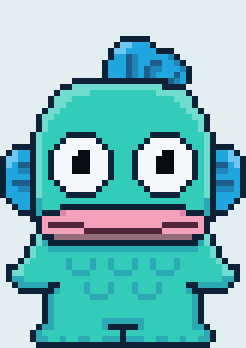

# HangyoPlop

**A pixel-art Hangyodon who lives on your desktop.**
He watches your cursor, types along with you, naps when you're away, reminds you to stretch and drink water, and thinks along while your coding agent works.

Fully offline · no account · no telemetry · Windows

</div>

---

HangyoPlop is a desktop pet inspired by [Comnyang](https://comnyang.com/en), rebuilt from scratch around Hangyodon and made to run entirely on your machine. There's no sign-in or license check, and it never connects to the internet. Settings stay in a JSON file on your PC.

> Fan project. Hangyodon is a Sanrio character; this project isn't affiliated with or endorsed by Sanrio or Comnyang.

## Contents

- [Quick start](#quick-start)
- [What he does](#what-he-does)
- [Screenshots](#screenshots)
- [Using HangyoPlop](#using-hangyoplop)
- [Coding agents](#coding-agents)
- [Art and animation](#art-and-animation)
- [Project layout](#project-layout)

## Quick start

**Easiest:** double-click **`HangyoPlop.cmd`** in this folder. The first run installs dependencies (you need [Node.js](https://nodejs.org) 18 or newer), then Hangyodon appears in the bottom-right corner of your screen.

**Add him to the Desktop and Start Menu:**

```sh
npm install
npm run shortcut
```

You then get a **HangyoPlop** icon on your Desktop and in the Start Menu that starts him with no console window.

**Make a standalone app** (no Node.js needed on the PC that runs it):

```sh
npm run dist
```

This creates two files in `dist/`:

| File | What it is |
|---|---|
| `HangyoPlop-Setup-0.1.0.exe` | Installer with Start Menu and Desktop shortcuts |
| `HangyoPlop-0.1.0-portable.exe` | Single file you can run from anywhere |

Windows SmartScreen warns about unsigned apps the first time. Choose **More info → Run anyway**.

**For development:** `npm start` runs from source. It also works from VS Code's terminal, which sets `ELECTRON_RUN_AS_NODE` and would otherwise stop Electron from starting.

## What he does

<table>
<tr>
<td align="center">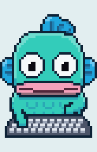<br><b>Types with you</b><br>Paws hit random keys on his keyboard, on the side of the key you pressed.</td>
<td align="center">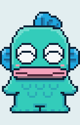<br><b>Purrs when petted</b><br>Stroke his head with the cursor for hearts and a bubbly gurgle.</td>
<td align="center">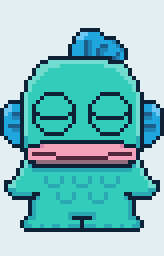<br><b>Naps</b><br>Dozes off after 45 seconds without mouse or keyboard input.</td>
</tr>
<tr>
<td align="center">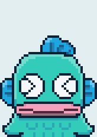<br><b>Jumps</b><br>Double-click him, or wait for your coding agent to finish.</td>
<td align="center">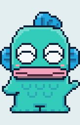<br><b>Waves</b><br>Click him, or he waves to get your attention for reminders.</td>
<td align="center">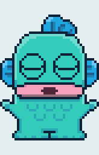<br><b>Stretch breaks</b><br>Grows big in the middle of the screen so you stretch too.</td>
</tr>
</table>

<p align="center">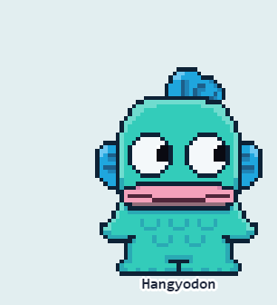<br>
<i>While Claude Code or Codex works, a thought bubble with "…" sits beside him. When the task is done he jumps and the bubble turns into a light bulb.</i></p>

### All reactions

| You do | Hangyodon |
|---|---|
| Move the cursor | His eyes follow it |
| Stroke his head with the cursor | Purrs: happy face, hearts, bubbly sound |
| Shake the cursor fast near him | Hunting pose, wiggling toward it |
| Type | Taps random keys on his keyboard with the paw on the side you pressed |
| Scroll | Unrolls a paper scroll |
| Drag him | Stretches like mochi and wobbles; springs back when you let go |
| Drag him past a screen edge | Peek mode: lies sideways and peeks in from the edge |
| Click / double-click | Waves and blubs / jumps |
| Leave the computer for 45 s | Falls asleep, Zzz |
| A coding agent is working | "…" thought bubble beside his head |
| The agent finishes | Jumps; the bubble turns into a light bulb |
| The agent needs approval | Waves: "needs your attention!" |

## Screenshots

| | |
|---|---|
| 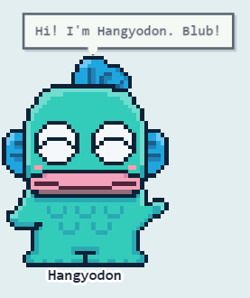<br>Speech bubbles stay on screen wherever he is. | 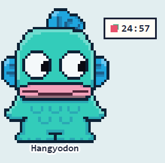<br>Pomodoro timer beside him (hover it to pause or reset). |
| 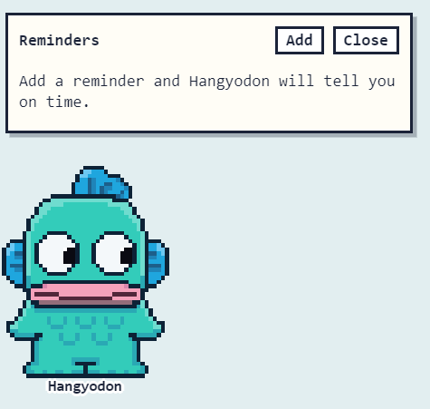<br>Reminders: a time and a message, once or on chosen days. | 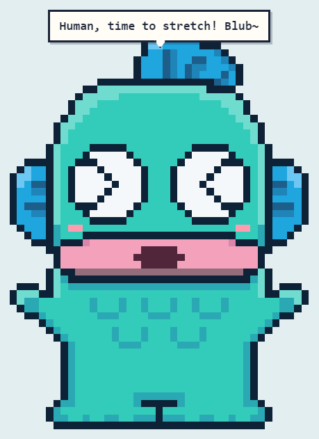<br>Stretch and drink-water breaks on a timer. |
| 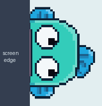<br>Peek mode when he's dragged to a screen edge. | 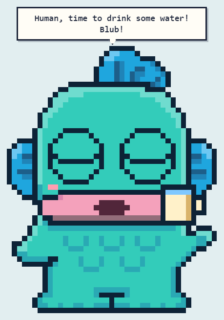<br>Drink-water break. |

## Using HangyoPlop

Right-click Hangyodon, or the tray icon, to open the menu.

| Menu | What's in it |
|---|---|
| **Move to center / Peek mode** | Bring him back, or hide him at the left or right edge. "Notify in peek mode" lets him pop out for reminders. |
| **Size** | 2× to 6× (his art is 41 × 58 pixels; every size stays crisp). |
| **Pomodoro** | Start, pause, resume, reset; focus time (15–60 min or custom) and break time. |
| **Break stretch / Drink water** | Remind you every 15 min to 2 h, or start one now. |
| **Reminders** | Open the reminders panel; optionally keep a clock button next to him. |
| **Name** | Your name (used in reminders), his name, and whether to show it under him. |
| **Fixed message** | A note pinned above his head. |
| **Colors** | 8 color presets plus a color editor for skin, fins and lips, with saved looks. |
| **Show off my Hangyodon** | Records a 5–30 second `.webm` clip of him. |
| **Sound** | Mute and volume. All sounds are synthesized in the app, with no audio files. |
| **Agent monitoring** | Turn Claude Code, Codex CLI and the local hook on or off. |
| **Open at login** | Start with Windows. |

Settings are saved in `%APPDATA%\HangyoPlop\settings.json`.

## Coding agents

HangyoPlop reacts to coding agents running on the same computer. It reads their session logs locally and never connects to the internet.

| Agent | How it's detected |
|---|---|
| Claude Code | `~/.claude/projects/**/*.jsonl` |
| Codex CLI | `~/.codex/sessions/**/rollout-*.jsonl` |
| Anything else | POST to the local hook below |

Any tool can report its state to the local hook:

```sh
curl -X POST http://127.0.0.1:23457/agent-state -d "{\"agent\":\"mytool\",\"state\":\"complete\"}"
```

`state` is one of `thinking`, `working`, `notification`, `complete`, `error`, `idle`. The server only listens on `127.0.0.1`.

## Art and animation

<p align="center">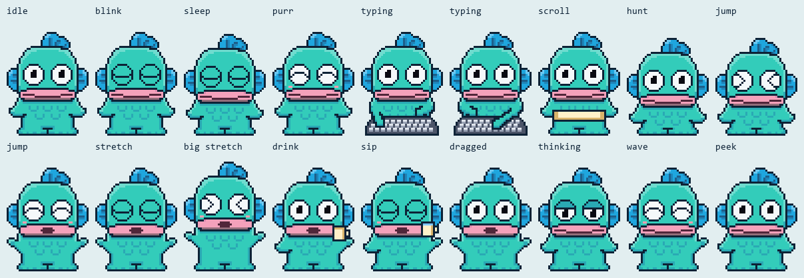</p>

The sprite is a cleaned-up trace of a hand-drawn Hangyodon reference (`art/ref/reference.png`). [`scripts/extract-reference.py`](scripts/extract-reference.py) recovered its original pixel grid from the upscaled image, and the master sprite was then touched up by hand.

Every animation pose is generated from that one master sprite in [`art/hangyodon.px.js`](art/hangyodon.px.js), written in the [pxl](.claude/skills/pxl-pixel-art) pixel-art DSL. The generator changes only what each pose needs: eyes, mouth, arms, a squash, or a prop. The pupils aren't part of the sprites; the app draws them every frame so they follow your cursor.

```sh
npm run art      # rebuild the sprites after editing the art
```

How the animation works:

- **Poses:** each frame the app picks one of 25 pose sprites based on what's going on and how much time has passed.
- **Simulated motion:** on top of the pose, the app adds the jump arc, the mochi stretch while dragging and the wobble spring.
- **Effects:** hearts, Zzz and the bubbles are small HTML elements.

## Project layout

```
HangyoPlop.cmd              double-click launcher
art/hangyodon.px.js         the master sprite and every pose
src/main/main.js            windows and layouts (normal, peek, break), drag, global input,
                            breaks, reminders, pomodoro, menus
src/main/agents.js          coding-agent log tailing and the local hook server
src/main/store.js           JSON settings
src/renderer/pet/pet.js     pose state machine, drawing, eye tracking, petting, hunting,
                            bubbles, reminders panel, recording
src/renderer/pet/sound.js   synthesized sounds
src/renderer/colors/        color editor window
src/shared/colors.js        palettes and presets
scripts/                    start, shortcut, sprite copy, reference extraction, README media
```

**Developer tour:** `HANGYO_TOUR=<dir> npm start` walks through every state, saves window captures to `<dir>`, then quits. Add `HANGYO_TOUR_SCALE=3 HANGYO_TOUR_SEQ=1` to capture at 3× plus a frame sequence of Claude thinking and finishing. `python scripts/make-readme-media.py <dir>` turns those captures into the images in this README.

## Built with

[Electron](https://www.electronjs.org/) · [uiohook-napi](https://github.com/SnosMe/uiohook-napi) for global keyboard and scroll events · [electron-builder](https://www.electron.build/) · pxl for the pixel art
